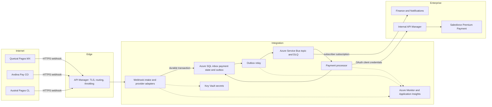
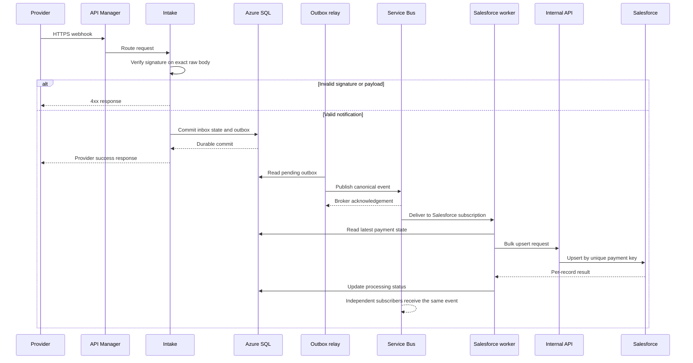

# Premium Payment Notifications — Solution Design

## 1. Goals and boundaries

The integration receives provider webhooks in Mexico, Colombia and Chile, authenticates them, normalizes them, and asynchronously records payment state in Salesforce and publishes a canonical event for Finance and Notifications. It does not implement either downstream consumer and must never write `Policy__c.Status__c`. Salesforce automation owns policy reinstatement/suspension.

The design uses the existing API Manager as the only public entry point. Provider-specific authentication and mapping are isolated adapters; the durable intake, lifecycle, persistence and publication flow is shared.

## 2. Context and trust boundaries

Only the API Manager is internet-facing. TLS protects transport. Provider secrets and Salesforce credentials are retrieved from Key Vault via managed identities; they are not embedded in application settings. Internal Salesforce access is routed through the API Manager, not point-to-point. Operations access to status records is authenticated and authorized separately from provider endpoints.

## 3. Notification sequence and failures

The outbox relay publishes to a topic with independent subscriptions for the Salesforce worker and downstream consumers. The final self-message represents independent delivery to Finance and Notifications; those consumers are not called by the Salesforce worker. Delivery is at-least-once. Consumers and Salesforce writes are idempotent; a crash between remote success and local acknowledgement can therefore cause safe redelivery, not duplicate business payment records.

Salesforce error handling is handled by the worker: retry 401 after refreshing the token; retry 5xx and row-lock errors with bounded backoff; pause on `403 REQUEST_LIMIT_EXCEEDED`; classify invalid records and missing policies for operations and DLQ. Intake failures before durable commit return non-2xx. Duplicate notifications are acknowledged only after the durable duplicate is confirmed.

## 4. Canonical payment event

The contract is provider-independent. `schemaVersion` is explicit. Amounts are represented as integer minor units plus ISO currency so no floating-point conversion is required; CLP uses exponent zero and its integer amount is preserved. Provider-specific raw payloads, payer name/ID/email and payment tokens are excluded.

| Field | Meaning |
|---|---|
| `schemaVersion` | Version of this canonical contract, initially `1`. |
| `eventId` | Stable ID for this provider state-change event; deduplicates event delivery. |
| `paymentKey` | Stable business payment key: `<country>:<provider>:<providerTransactionId>`. |
| `country` | `MX`, `CO` or `CL`. |
| `provider` | `Quetzal`, `Andina` or `Austral`. |
| `providerEventId` | Provider event/notification identifier, when available. |
| `providerTransactionId` | Charge, transaction or payment identifier. |
| `policyNumber` | Validated policy reference, e.g. `POL-CO-000187342`. |
| `status` | `pending`, `captured`, `failed` or `refunded`. |
| `amountMinor` | Integer amount in the currency's minor unit (CLP exponent 0). |
| `currency` | Uppercase ISO 4217 currency (`MXN`, `COP`, `CLP`). |
| `occurredAt` | Provider state-change time in UTC. |
| `receivedAt` | Meridian receipt time in UTC. |
| `correlationId` | Meridian trace identifier; propagated across processing. |
| `reasonCode` | Optional sanitized failure/reversal reason; no payer data. |

### Provider mapping

| Provider | Event identity / payment identity | State mapping | Amount and time | Verification |
|---|---|---|---|---|
| Quetzal (MX) | `id` / `data.charge.id` | `charge.succeeded` → captured; `charge.failed` → failed; `charge.refunded` → refunded | `amount` and `amount_refunded` are minor-unit integer MXN; `created` is event time; use `paid_at`/`refunded_at` for state time where present | HMAC-SHA256 lowercase hex of `t.<exact raw body bytes>`; reject timestamp skew >300 seconds; accept any matching rotation signature; constant-time comparison |
| Andina (CO) | Event ID derived from `transaccion.id + estado + fecha_transaccion` (attempt ID `notificacion_id` separately) / `transaccion.id` | `PENDIENTE` → pending; `APROBADA` → captured; `RECHAZADA` → failed; `REVERSADA` → refunded | Decimal major-unit string converted exactly to COP minor units (two decimals); `fecha_transaccion` is state time | Base64 HMAC-SHA256 of `<X-Andina-Timestamp>.<exact raw body bytes>`; enforce recommended ±10-minute timestamp window |
| Austral (CL) | `eventId` / `payment.paymentId` | `PAYMENT_CONFIRMED` → captured; `PAYMENT_REJECTED` → failed; `PAYMENT_REVERSED` → refunded | Integer CLP amount, exponent zero; `payment.occurredAt` is state time | Lowercase hex HMAC-SHA256 of exact raw body; no signed timestamp, so rely on signature and durable event-ID replay detection |

For Andina, the attempt identifier changes on retries, so it is not the business idempotency key. A deterministic state-event ID is derived from stable business state fields; the attempt ID remains searchable for operations. If the provider later supplies an immutable event ID, the adapter can adopt it without changing the shared flow.

## 5. Idempotency, ordering and lifecycle

- `paymentKey` is uniquely constrained in the local payment table and maps to Salesforce `Payment_Key__c` (Text(80), External ID, Unique). Format includes country, provider and transaction ID; validate its length and provider ID constraints before acceptance.
- A unique inbox key per provider event prevents duplicate state events. For Quetzal/Austral use their stable event IDs. For Andina use transaction ID + state + state-change timestamp, while storing each `notificacion_id` in a separate delivery table/index.
- Intake transactionally records the normalized event, provider identifiers, latest accepted payment state, and outbox row. A duplicate is acknowledged only after the existing durable record is confirmed.
- State transitions are applied by provider event time, not arrival time. Older events are retained for audit/status but cannot overwrite a newer state. `pending` cannot downgrade a later terminal state. A later `refunded`/reversed event supersedes captured. A failed attempt does not create a second payment identity.
- If timestamps tie and states conflict, quarantine the conflict rather than guess; specifications provide no common provider sequence number. This assumption is recorded in `docs/ASSUMPTIONS.md`.
- Salesforce upsert by unique `Payment_Key__c` provides a second idempotency barrier. Worker sends the latest eligible payment projection; `Status_Changed_At__c` and `Last_Event_Id__c` are updated with the applied state.
- Publication is at-least-once via outbox; downstream consumers receive stable event IDs and must deduplicate.

## 6. Errors, retries, DLQ and replay

- **Webhook edge:** reject failed authentication, stale signed timestamps, malformed payloads and unsupported event types with non-2xx; do not persist/acknowledge them as accepted. Do not acknowledge before durable commit. Respond within each provider's deadline (Andina 5 seconds; Quetzal/Austral 10 seconds).
- **Durable intake failure:** return non-2xx so provider retry policies can act. This is why persistence and normalization must be bounded and fast.
- **Outbox/broker transient errors:** retry with exponential backoff and jitter; retain outbox state until broker acknowledgement. Alert on outbox age and backlog.
- **Salesforce 401:** refresh cached OAuth client-credentials token once and retry. Never request a token per API call.
- **Salesforce 5xx / transient lock errors:** bounded exponential backoff with jitter; honor `UNABLE_TO_LOCK_ROW` retry guidance. Respect max 25 concurrent requests.
- **Salesforce `403 REQUEST_LIMIT_EXCEEDED`:** stop or sharply reduce Salesforce dispatch, alert, preserve queued work and resume with controlled rate after the org recovers; do not hot-loop retries.
- **Salesforce data 400 / missing policy:** do not blindly retry. Record sanitized per-record error and dead-letter after classification; operations corrects mapping/data and replays.
- **DLQ/replay:** persist reason, attempts and status; authorize replay; replay the original normalized event or latest payment projection through the same idempotent path. Never bypass signature/audit history or blindly replay raw PII-bearing request bodies.
- Provider retries stop after their documented windows, so reconciliation/alerting on missing expected events and aged unresolved notifications is required.

## 7. Capacity, Salesforce budget and freshness

### Intake and messaging

The peak stated as 40 notifications/second for 15 minutes is 36,000 notifications. The ingress and durable store must sustain at least 40/sec for that interval with headroom (target 2×, 80/sec) and absorb a burst if processing is unavailable. Normal average is about 0.17/sec (15,000/day); peak-day average is about 1.39/sec (120,000/day). Service Bus buffers Salesforce outages and smooths load.

### Salesforce calls

Use composite bulk upsert with up to 200 records per request and `allOrNone=false`. At 120,000 distinct payment updates/day, the theoretical minimum is 600 calls/day; duplicates and coalescing of multiple state changes to the latest state reduce this. Even a conservative 10× allowance (6,000 calls/day) is 4% of the 150,000-call integration budget. The budget is monitored with a safety threshold and is not treated as guaranteed org-wide capacity. Cache/reuse OAuth tokens. Limit concurrency to 25 and configure a lower initial worker cap (for example, 10) with adaptive throttling.

At 40 events/sec, batching 200 records takes at most 5 seconds to fill a batch; use a shorter flush interval (for example, 1 second) or batch-size threshold to meet freshness, then send up to 25 concurrent requests only when backlog requires it. Track queue age and API consumption, and throttle well before the integration's allocation is exhausted.

### Freshness and availability caveat

Under healthy Salesforce conditions, target a one-second intake/outbox path, one-second batch flush, and Salesforce bulk-call p95 around four seconds, leaving substantial margin against five minutes. Alert and scale workers based on oldest-message age.

Salesforce has approximately 97% monthly availability and outages commonly last 5–90 minutes. The 99.5% within-one-hour objective cannot be guaranteed during an outage over one hour; preserve messages and recover promptly, but report this as an explicit dependency/SLO exception rather than promise an impossible result. This conflict is recorded in assumptions and should be agreed with the service owner.

## 8. Persistence and operational lookup

Azure SQL stores:

- `NotificationInbox`: provider, country, provider event ID, delivery/attempt ID, transaction ID, received time, event time, normalized status, correlation ID, processing status, retry/error classification. Unique indexes enforce provider event identity; lookup indexes cover provider + event/attempt ID and provider + transaction ID.
- `PaymentState`: unique `paymentKey`, policy number, currency/amount, current status, latest provider state time, last event ID, Salesforce synchronization status/time.
- `Outbox`: canonical event payload, stable event ID, creation/publication state and attempt metadata; unique event ID.

Do not store raw webhook bodies, payer details or tokens. Limit retention of operational notification metadata to a documented period (initial proposal: 90 days online, then delete or aggregate, subject to legal/regulatory retention approval). Payment state remains as needed for reconciliation and Salesforce consistency. Encrypt at rest, restrict SQL access by managed identity and role, and audit privileged status searches. The 90-day operational retention is an assumption to confirm.

Operations uses a protected internal status-query API through API Manager, searchable by provider event/attempt ID or transaction ID. It returns status, timestamps, correlation ID and sanitized error category, never raw payload or personal data. Access is role-based, audited, and rate-limited. Dashboards expose per-country received/recorded/failed/dead-lettered counts, oldest pending age, freshness percentiles, duplicates, signature failures, Salesforce call usage, and DLQ depth.

## 9. Security and extensibility

Use provider-specific secret versions in Key Vault with rotation support. Verify signatures over exact raw bytes before parsing; compare HMAC values in constant time. Enforce TLS, request-size limits, content type, timestamp windows where signed, and provider-specific endpoint/rate controls. Use managed identities for Azure resources and least-privilege roles. Salesforce uses OAuth 2.0 client credentials with secret stored in Key Vault, token caching, and API Manager mediation.

Each provider adapter implements verification, parsing, mapping, and provider-specific ID/timestamp semantics behind a shared intake interface. A new provider adds an adapter, configuration and mapping tests; the common durable workflow, event schema, lifecycle, Salesforce sync and operations lookup remain unchanged.
